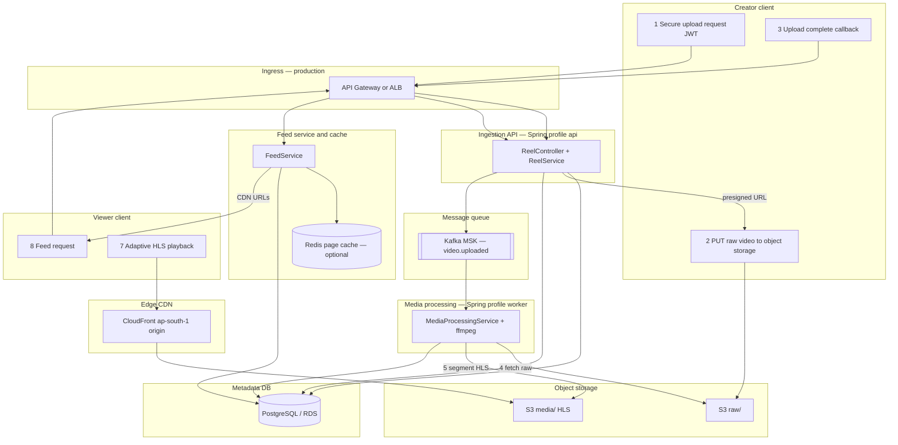

# Indieestate platform architecture (Instagram-aligned)

This document maps a **Reels-style reference architecture** (creator upload → object storage → async transcode → CDN playback → feed) to **this repository**: what exists today, what runs in AWS production, and what to add for larger scale.

Read [`REELS_ARCHITECTURE.md`](REELS_ARCHITECTURE.md) for S3/IAM troubleshooting, [`UAT_REELS_SETUP.md`](UAT_REELS_SETUP.md) for UAT/prod env setup, and [`infra/terraform/README.md`](../infra/terraform/README.md) for ECS/RDS/MSK deployment.

## Reference flow (creator + viewer)

Same **pattern** as large short-video apps: metadata and auth through the API, **video bytes never through the API**, async **Kafka** transcode, **HLS on CDN**, feed served from **Postgres + Redis cache**.



## Step-by-step mapping

| Step | Reference label | Indieestate component | Status |
|------|-----------------|------------------------|--------|
| 1 | Secure upload request | `POST /api/reels/uploads` (JWT), `videos.status = UPLOADING` | **Implemented** |
| 2 | Raw video to object storage | Presigned **PUT** to `raw/{videoId}/original.*` (single request; not gateway chunk relay) | **Implemented** |
| — | Metadata pending | PostgreSQL `videos`, `reels` | **Implemented** (single DB, not sharded) |
| 3 | Event triggered | **`POST /api/reels/complete`** → `VideoEventPublisher` → topic **`video.uploaded`** | **Implemented** (API-driven; optional S3→EventBridge→Kafka in Phase 2) |
| 4 | Fetch raw | `MediaWorker` / `MediaProcessingService` downloads from S3 | **Implemented** |
| 5 | Segment and transcode | `FfmpegVideoTranscodeService` → multi-bitrate **HLS** (fMP4 segments) | **Implemented** |
| — | MPEG-DASH | Not used | **Not planned** (HLS covers Android/iOS) |
| 6 | Origin push | Worker **PUT** `media/{videoId}/hls/...` + poster | **Implemented** |
| 7 | Adaptive stream | Client plays `REELS_CDN_BASE_URL` + master playlist | **Implemented** |
| 8 | Feed request + cache | `GET /api/reels` → **`FeedService`** → Postgres; **`RedisReelFeedCache`** when enabled | **Implemented** |
| 9 | Personalized candidates / ranking | — | **Not implemented** (global chronological feed) |

### Ingress naming

| Reference | Production target | Local dev |
|-----------|-------------------|-----------|
| API Gateway | **ALB** → ECS API tasks (or add API Gateway in front of ALB) | Spring Boot `:8080` |

### Code map

| Layer | Package / class |
|-------|-----------------|
| Ingestion API | `ReelController`, `ReelService` (`createUpload`, `complete`) |
| Media processing | `MediaProcessingService`, `MediaWorkerListener`, `MediaWorker`, `FfmpegVideoTranscodeService` |
| Feed service | `FeedService`, `ReelFeedCache`, `RedisReelFeedCache` |
| Queue | `KafkaVideoEventPublisher`, topic `app.reels.kafka.uploaded-topic` |

## Production AWS (target)

Single region **`ap-south-1`** (India-first). CloudFront **Price Class 200** is reasonable if most viewers are in India/Asia (billing knob, not a substitute for feed scaling).

| Reference box | AWS service |
|---------------|-------------|
| API Gateway / ingress | **ALB** (+ optional API Gateway) |
| Metadata DB | **RDS PostgreSQL 16** |
| Object storage | **S3** (raw + media prefixes, one bucket) |
| Kafka | **MSK** |
| Media processing | **ECS Fargate** worker tasks (ffmpeg in image) |
| Feed cache | **ElastiCache Redis 7** (`REELS_REDIS_ENABLED=true`) |
| CDN | **CloudFront** → S3 OAC |

**API task:** `SPRING_PROFILES_ACTIVE=postgres,api,prod`, `REELS_RUN_MEDIA_WORKER=false`  
**Worker task:** `SPRING_PROFILES_ACTIVE=postgres,worker,prod`, `REELS_RUN_MEDIA_WORKER=true`

## Scaling phases (honest roadmap)

Billions of DAU requires **feed graph, ranking, and sharded storage** in addition to the video pipeline. This repo implements the **video pipeline + global feed**; treat higher phases as explicit product/infra work.

| Phase | Scope | Delivers |
|-------|--------|----------|
| **0 — Today** | Local Postgres, optional Docker Kafka/Redis, S3+CloudFront | Full upload/transcode/feed path in code |
| **1 — Production MVP** | RDS, MSK, ElastiCache, ECS split, secrets, `prod` profile | Instagram-**pattern** media path at real traffic |
| **2 — Throughput** | Read replicas, API/worker autoscaling, S3 lifecycle on `raw/`, optional **S3 ObjectCreated → EventBridge → MSK** as backup trigger | Higher upload/transcode volume |
| **3 — Feed scale** | Follow graph, **fan-out on write** (Redis timelines) or hybrid, cursor feed sharding | Home feed latency at large follower counts |
| **4 — Discovery** | Candidate retrieval, ranking, reranking (optional ML) | Personalized Play tab |

Phase 1 matches what [`infra/terraform/README.md`](../infra/terraform/README.md) describes. Phases 3–4 are **not** in the codebase yet (no follow graph, no ranking service).

## Differences from a generic “Instagram diagram”

Keep these in mind so diagrams stay accurate:

1. **Upload trigger** — Primary path is **`complete` → Kafka**, not S3 event → ingestion API first.
2. **Upload shape** — **Presigned single PUT**, not chunked ingest through the gateway (Phase 2 can add S3 multipart presign).
3. **Database** — **One PostgreSQL** database, not DynamoDB or Postgres shards.
4. **Feed** — **Global** `READY`/`PROCESSING` reel list with cursor pagination, not per-user precomputed timelines.
5. **Transcode** — **ffmpeg** on ECS; **MediaConvert** is a stub (`REELS_TRANSCODE_PROVIDER=mediaconvert`).

## Local parity

```bash
# Infra only
docker compose up -d postgres redis kafka

# API (no ffmpeg consumer)
# .env: REELS_KAFKA_ENABLED=true, REELS_RUN_MEDIA_WORKER=false
./start-backend.sh

# Media worker
./scripts/start-media-worker.sh
```

Full stack in Docker: `docker compose -f docker-compose.yml -f docker-compose.app.yml up --build`.

## Environment checklist (production)

| Variable | API | Worker |
|----------|-----|--------|
| `REELS_KAFKA_ENABLED` | `true` | `true` |
| `REELS_RUN_MEDIA_WORKER` | `false` | `true` |
| `REELS_REDIS_ENABLED` | `true` | `false` (typical) |
| `REELS_ALLOW_DIRECT_UPLOAD` | `false` | `false` |
| `REELS_SKIP_S3` | `false` | `false` |
| `JWT_SECRET` | Secrets Manager | — |
