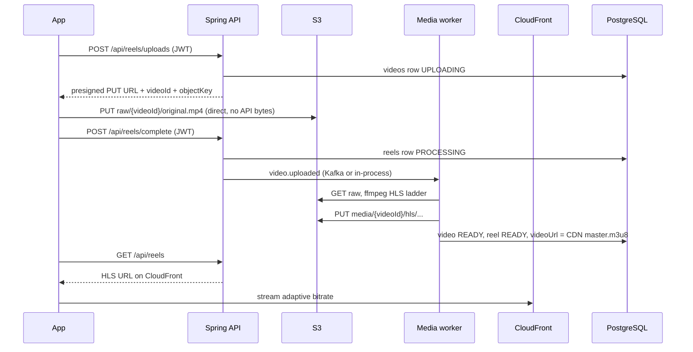

# Reels architecture (scalable / Instagram-style)

This is the **production** path. Do not route phone video through the Spring Boot JVM in production — that does not scale.

## Flow



## Why presigned S3?

| Concern | Presigned upload | Multipart via API |
|--------|------------------|-------------------|
| API CPU / memory | Minimal | High (every byte through JVM) |
| Horizontal scale | Add API nodes; S3 absorbs upload | API becomes bottleneck |
| CDN playback | HLS on CloudFront | Would need separate pipeline |
| Same as Reels/TikTok/IG | Yes | No (dev shortcut only) |

## Configuration checklist (fix 403)

Your backend log `Cannot access reels bucket … Forbidden (403)` means **the IAM user in `.env` cannot access the bucket**. The phone will get **403 on PUT** for the same reason. This is **not** an Android CORS issue.

1. **Bucket name** — must match exactly (e.g. `indiestate-reels-uat` in `ap-south-1`). Typos in `.env` cause HeadBucket/PutObject failures.

2. **IAM policy** (attach to the user whose keys are in `AWS_ACCESS_KEY_ID`):

```json
{
  "Version": "2012-10-17",
  "Statement": [
    {
      "Sid": "IndieestateReelsBucket",
      "Effect": "Allow",
      "Action": [
        "s3:PutObject",
        "s3:GetObject",
        "s3:HeadObject",
        "s3:DeleteObject",
        "s3:ListBucket"
      ],
      "Resource": [
        "arn:aws:s3:::indiestate-reels-uat",
        "arn:aws:s3:::indiestate-reels-uat/*"
      ]
    }
  ]
}
```

3. **Bucket policy** — must allow that IAM principal (or use IAM-only access on a private bucket with Block Public Access on).

4. **Presigned PUT** — IAM must include `s3:PutObject` on `raw/*`. No ACL required if using bucket-owner-enforced object ownership.

5. **CORS** — required for **web** clients; configure PUT/GET on the bucket (see root README). Native Android/iOS use HTTP PUT to the presigned URL; CORS does not apply there.

6. **CloudFront** — `REELS_CDN_BASE_URL` must point at the distribution that reads `media/` keys via OAC/OAI.

7. **Verify** — restart backend; log should say `Reels S3 bucket '…' is reachable`. Then upload from the app.

## Dev-only escape hatch

`REELS_ALLOW_DIRECT_UPLOAD=true` + `REELS_SKIP_S3=true` exposes `DIRECT_MULTIPART` in `GET /api/reels/upload-config`. The app uploads via `POST /api/reels/upload` **only in that mode**. Never enable in production.

## Scale-out (V2)

With `REELS_KAFKA_ENABLED=true` and Redis, transcode runs on separate workers; API stays thin. Postgres remains source of truth for metadata.
